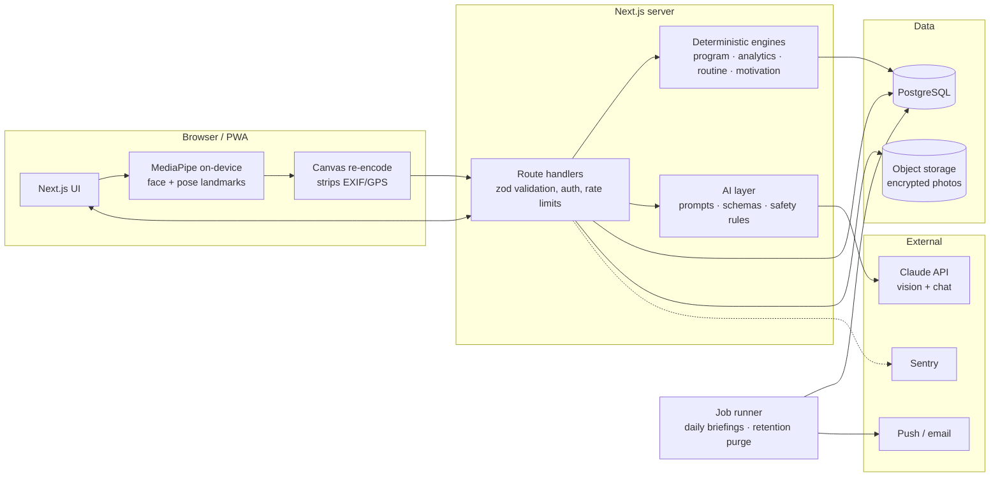
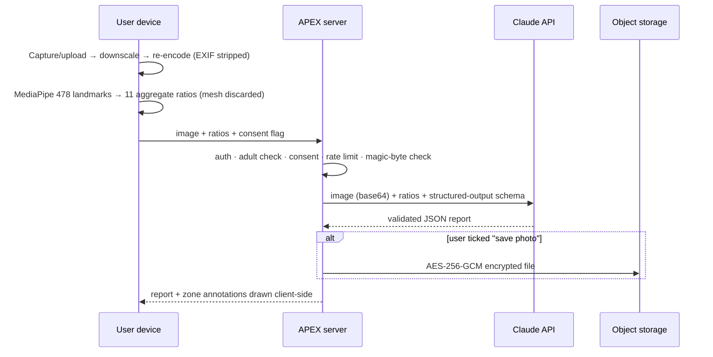
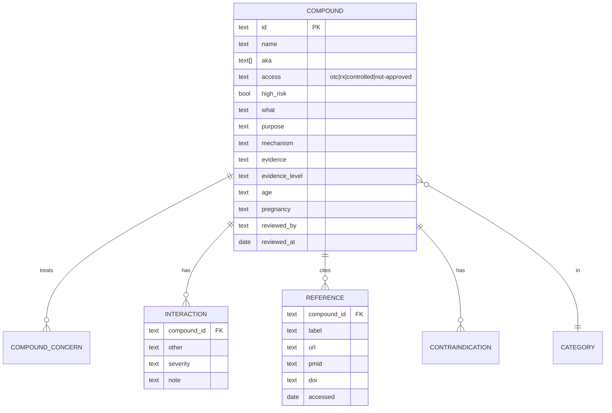
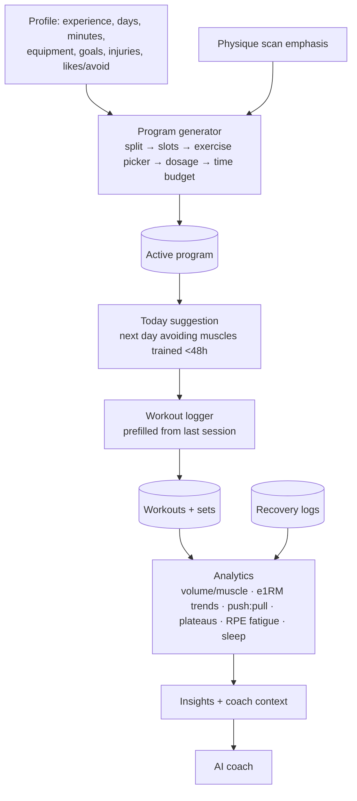
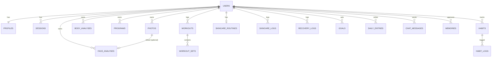
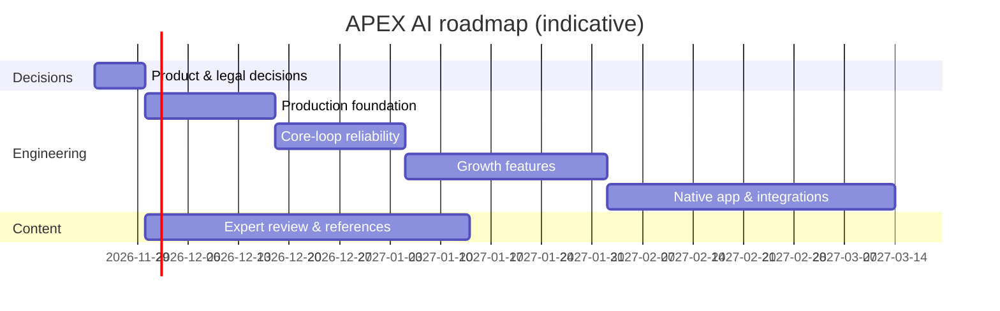

# APEX AI — Technical & Product Diagnostic

_Prepared 17 Nov 2026. Scope: the full specification across all three rounds of requests, assessed against the codebase as it exists in this repo (~8,700 lines, built in the previous session)._

**Status note.** You asked for this diagnostic *before* implementation, but a working first version already exists. So this report does two jobs:

1. It's the forward-looking plan you asked for.
2. It audits what's built: what holds up, what's weak, and what to change.

Your most recent change request (attractiveness scores everywhere, broader prescription recommendations) is **paused** and evaluated in §2.4 and §11.

Classification legend used throughout:

| Tag | Meaning |
|---|---|
| ✅ **Fully achievable** | Buildable with open-source / in-house code, no special dependency |
| 🔌 **External API** | Achievable, but depends on a paid third-party API or service |
| 🔬 **Needs research** | Feasible in principle; needs validation, expert review, or legal input before shipping |
| ⛔ **Not reliably achievable** | Current technology can't do it accurately/safely; ship a reduced version or don't ship |

---

## 1. Architecture

### Recommendation

| Layer | Recommendation | Why | Current build |
|---|---|---|---|
| Frontend | **Next.js 15 (App Router) + React 19 + Tailwind** | One codebase for web + PWA; server components keep secrets server-side | ✅ Built |
| Mobile | **PWA first**, then React Native/Expo if App Store presence matters | Camera, offline and install work in a PWA; native adds push reliability + HealthKit | ❌ Not built |
| Backend | **Next.js route handlers** (same deployable) → split out a worker service only for background jobs | Avoids a second service until there's a reason | ✅ Built |
| Database | **PostgreSQL** (Neon / Supabase / RDS) in production | Concurrency, backups, point-in-time recovery, row-level security | ⚠️ SQLite now. Fine for one server, must migrate before scaling |
| ORM | **Drizzle** (typed SQL, easy migration from current raw SQL) | Current SQL is portable | ⚠️ Raw SQL |
| Auth | **Keep in-house sessions** *or* adopt **Auth.js / Clerk / Supabase Auth** for email verification, password reset, OAuth, 2FA | Built auth is sound but missing recovery flows | ⚠️ Partial |
| Object storage | **S3 / Cloudflare R2** with server-side encryption + app-level AES-GCM | Local disk doesn't survive redeploys or scale | ⚠️ Local disk (encrypted) |
| Background jobs | **Inngest / Trigger.dev / a queue + cron** | Daily push messages, weekly reviews, retention purges, AI batch work | ❌ Missing |
| Notifications | **Web Push + email (Resend/Postmark)**; native push later | "Every morning" motivation needs push | ❌ Missing |
| Hosting | **Vercel or Fly.io/Render** (app) + managed Postgres + R2 | Low ops burden | Not deployed |
| Observability | **Sentry** (errors) + structured logs + AI call metrics | Needed before real users | ❌ Missing |

### System diagram

### Photo-analysis data flow (privacy-critical path)

---

## 2. AI capabilities

### 2.1 Models & APIs

| Job | Recommended | Alternative | Notes |
|---|---|---|---|
| Face/skin photo analysis | **Claude Opus 5.5** (vision + structured outputs) | Claude Sonnet 5.5 at ~half cost | Structured outputs guarantee schema-valid JSON. Run an eval to see whether Sonnet holds quality |
| Physique scan | Claude Opus 5.5 | Sonnet 5.5 | Same pattern, 1–3 images |
| Conversational coach | **Claude Sonnet 5.5** or Opus 5.5 | Haiku 5.5 for simple Q&A routing | Chat is the highest-volume cost; see §9 |
| Program generation | **Deterministic engine** (built) + optional LLM explanation | — | LLM-generated programs are less consistent and harder to test; keep the engine authoritative |
| Exercise recommendations | Deterministic (database + rules) | LLM for free-text questions | Built |
| Facial landmarks | **MediaPipe Face Landmarker** (on-device, free) | — | Built, self-hosted model |
| Pose landmarks | **MediaPipe Pose Landmarker** (on-device) | — | Built |
| Image preprocessing | Browser canvas (resize, EXIF strip) | `sharp` server-side for HEIC and re-validation | Partly built; HEIC support is browser-dependent |
| Daily motivation | Deterministic composer (built) | LLM-personalised variant via nightly batch at 50% cost (Batch API) | Optional |

### 2.2 Classification

| Feature | Class |
|---|---|
| Conversational coaching with user context | 🔌 External API |
| Offline fallback assistant | ✅ Fully achievable (built) |
| Program generation & progression | ✅ Fully achievable (built) |
| Skin observations from a photo | 🔌 External API + 🔬 needs validation (see §3) |
| AI memory with consent | ✅ Fully achievable (built) |

### 2.3 Known AI weaknesses

- **Hallucinated specifics.** Mitigated by constraining outputs to enums and database IDs: recommendations can only reference real entries. Keep this pattern everywhere.
- **Inconsistency.** The same photo can produce different reports. Use effort settings and schema constraints, and show trends across several analyses rather than single readings.
- **Refusals.** The model may decline some photo requests. These are handled with a `refusal` check and server-side fallbacks.
- **No evals yet.** Before launch, build a labelled eval set: ~100 consented photos rated by a dermatologist, plus coach conversations graded for safety and accuracy.

### 2.4 Attractiveness scores (your latest request)

| Aspect | Assessment |
|---|---|
| Technically possible? | Yes. A vision model will return a number. |
| Reliable? | **⛔ Not reliably achievable.** There's no ground truth. Published "attractiveness" models learn the biases of their raters and datasets (ethnicity, age, skin tone, lighting, camera). The same face scores differently across photos, so a score can move several points from lighting alone, and users will read that as real change. |
| Risk | Body-image harm, especially for young users. Bias complaints. App Store review friction: Apple has rejected "rate my face" apps. Reputational risk for a "premium" brand. |
| If you ship it anyway | Adults only; opt-in; scores framed as subjective, with a per-feature explanation; explicitly excluded inputs (race, ethnicity, skin tone); show a range or confidence, never a single precise number; never on the Progress dashboard as a headline metric. |
| Better alternative | **Objective, changeable metrics**: skin clarity extent, measured symmetry and proportions (already built), grooming and posture notes. These track progress that actually responds to effort. |

---

## 3. Facial analysis

| Capability | How | Class | Status |
|---|---|---|---|
| Landmark detection (478 pts) | MediaPipe Face Landmarker, WASM, on-device | ✅ | Built |
| Proportions & symmetry | Geometry on landmarks (thirds, ratios, midline-reflection asymmetry) | ✅, but angle-sensitive | Built, with pose warnings |
| Jawline / cheekbone *visibility* | Landmarks give widths. Visibility is mostly lighting and soft tissue → LLM description | 🔌 / 🔬 | Built (descriptive) |
| Skin texture, acne, redness, pigment, under-eye, oil/dryness | Vision LLM on the photo | 🔌 + 🔬 | Built. Accuracy unvalidated |
| Clinical-grade skin metrics (lesion counts, erythema index) | Requires controlled lighting, colour calibration and specialised models | ⛔ from a phone selfie | Not built. Don't claim it |
| Visual annotations | Landmark-anchored zones + LLM zone tags, drawn as SVG | ✅ | Built |
| Progress comparisons | Side-by-side photos + metric/extent deltas | ✅, but needs **standardised capture** | Built. Capture guide is weak |
| Medical diagnosis | — | ⛔ (and regulated) | Deliberately excluded |

**Recommended improvements**
1. **Guided capture:** a live overlay that only enables the shutter when head yaw/roll is under 5°, distance is right and lighting is even. This is the single biggest reliability gain for comparisons.
2. **Colour reference:** a white-balance check, or ask users to photograph against a white card.
3. **Average 2–3 shots** per session for measurements.
4. **Dermatologist review** of the prompt rubric and a validation study (🔬).

---

## 4. Medical / dermatology database

### Design (built as typed code, recommended to move to the DB + CMS)

| Aspect | Class | Status / note |
|---|---|---|
| Searchable entries, all requested fields | ✅ | 53 entries built, client-side search |
| Contraindications & interactions | ✅ as text. **Interaction checking** (e.g. against the user's medication list) → 🔌 licensed drug-interaction API (First Databank, Medi-Span, DrugBank) | Text only now |
| Authoritative references | ✅ / 🔬 | Currently **search links** (DailyMed, MedlinePlus, NCBI, PubMed), because specific URLs couldn't be verified from the build environment. Replace with curated PMIDs/DOIs after expert review |
| Content accuracy sign-off | 🔬 | **Needs a board-certified dermatologist + pharmacist review** before public launch. Add `reviewed_by` / `reviewed_at` |
| Coverage of "every" medication | ⛔ to hand-author | For breadth, ingest **openFDA / DailyMed SPL** label data (free) for the long tail and keep hand-written summaries for the top ~100 |
| Prescription *recommendations* | 🔬 legal | See §11.3 |

---

## 5. Exercise database

| Aspect | How | Class | Status |
|---|---|---|---|
| Library by 11 muscle groups with all fields | Typed data | ✅ | 89 exercises built |
| Searchable filters | Client-side | ✅ | Built |
| Interactive anatomy | Clickable SVG muscle map | ✅ | Built (stylised). A medically detailed atlas needs licensed illustrations → 🔌 |
| Demonstrations | Stick-figure keyframe animations per movement pattern | ✅ | Built (23 patterns) |
| Real video/3D demos | Licensed library (e.g. ExerciseDB API, Muscle & Motion licensing) or own production | 🔌 / 💰 | Not built. Biggest content cost (see §9) |
| Scale to 500+ exercises | Licensed dataset + editorial review | 🔌 | — |
| Content review | CSCS / physio sign-off | 🔬 | Needed |

---

## 6. Fitness coaching

| Feature | Class | Status |
|---|---|---|
| PPL, upper/lower, 4/5-day, full-body, body-part splits | ✅ | Built |
| Hypertrophy / strength / mobility / recovery education | ✅ | Built |
| Workout tracking, history, e1RM | ✅ | Built |
| Auto-progression (suggest next load) | ✅ | **Missing.** Easy win: double-progression suggestion in the logger |
| Deload detection | ✅ | Partial (RPE/soreness flags) |
| "Technique improvement" from history | ⛔ from numbers alone | Only indirect signals (stalls, RPE). Real form feedback needs video pose analysis → 🔬 |
| Wearable data (sleep, HRV, steps) | 🔌 HealthKit / Health Connect (needs native app) / Oura / Whoop APIs | Missing |
| Nutrition | ✅ / 🔌 food database (USDA FoodData Central is free) | **Missing entirely.** See §10 |

---

## 7. Data infrastructure (schema)

Current tables (all cascade on user delete):

**Recommended additions**

| Table | Purpose |
|---|---|
| `consents` (user, type, version, granted_at, revoked_at) | Legal proof of photo/biometric/AI consent (BIPA, GDPR) |
| `audit_log` | Security events: logins, deletions, exports |
| `email_verifications`, `password_resets` | Account recovery |
| `notification_prefs`, `push_subscriptions` | Morning briefing delivery |
| `ai_calls` (user, feature, model, tokens in/out, cost, latency, refusal) | Cost control and quality monitoring |
| `content_versions` | Versioned compound/exercise content with reviewer |
| `nutrition_logs`, `foods` | If nutrition is added |
| `subscriptions` | Billing state |
| Retention job | Auto-delete unsaved analysis inputs, stale sessions, and (optionally) photos after N months |

Move JSON-in-text columns (`report`, `plan`, `config`) to Postgres `jsonb`.

---

## 8. Security & privacy

| Area | Current | Recommendation | Class |
|---|---|---|---|
| Passwords | bcrypt (cost 12) | Keep. Add breached-password check (HIBP k-anonymity) | ✅ |
| Sessions | Random token, SHA-256 hashed at rest, httpOnly SameSite=Lax cookie, 30-day expiry | Add rotation and "sign out all devices" | ✅ |
| CSRF | Origin check + SameSite | Keep | ✅ |
| Rate limiting | SQLite fixed window | Move to Redis/Upstash when multi-instance | ✅ |
| 2FA / email verification / reset | ❌ | Add (TOTP or passkeys) | ✅ |
| Photo storage | AES-256-GCM, random names, owner-only route, `no-store` | Add object storage + KMS-managed keys and key rotation | ✅ |
| Biometrics | Mesh never leaves the device. Only 11 ratios are stored | **Legal review:** Illinois BIPA, Texas CUBI, Washington law treat "face geometry" as biometric. Stored ratios may qualify → written consent, published retention schedule, deletion within the legal window | 🔬 |
| AI provider data handling | Images sent to Anthropic per request | Disclose in the privacy policy. Review Anthropic's commercial data-retention terms; consider zero-data-retention agreements if offered for your use | 🔬 |
| Minors | <13 blocked. 13–17: no photo analysis/storage, no AI memory, conservative coach | Age is self-declared → add age assurance if marketing reaches teens; parental-consent flow for GDPR-K regions (under 16 in some EU states) | 🔬 |
| Deletion & export | Built (cascade + file removal; JSON export) | Also purge backups within a stated window | ✅ |
| Health data regulation | — | Consumer app: generally not HIPAA, but **FTC Health Breach Notification Rule**, **GDPR Art. 9** special-category data, Washington **My Health My Data Act** apply → privacy policy, breach plan, DPA with vendors | 🔬 legal |
| Prompt injection | Safety rules in system prompt; enums constrain outputs; Markdown renderer can't execute HTML | Add output moderation for the coach; eval set | ✅ |

---

## 9. Cost analysis

### Assumptions

- **AI pricing** (Anthropic list prices, Nov 2026): Opus 5.5 $4 / $20 per M input/output tokens. Sonnet 5.5 $2 / $10. Haiku 5.5 $0.10 / $0.50.
- **Per-call estimates:**
  - **Face analysis:** ~3.3k input tokens (image ~1.6k + prompts) and ~3.5k output (report + adaptive thinking). Opus ≈ $0.085, Sonnet ≈ $0.043.
  - **Physique scan:** 2 images. Opus ≈ $0.10, Sonnet ≈ $0.05.
  - **Coach message:** ~6k input (system + user context + history) and ~1.8k output. Opus ≈ $0.06, Sonnet ≈ $0.03, Haiku ≈ $0.0015. Prompt caching of the system prompt cuts input cost further.
- **Usage per monthly active user (MAU):** 4 face analyses, 2 physique scans, 60 coach messages. Heavy users will be 3–5× this.
- **"Users" = registered.** Assume **40% are monthly active**.
- **Third-party hosting prices** are typical published tiers from memory. **Verify before budgeting.**

### Per-active-user AI cost / month

| Model mix | Face | Body | Chat (60 msgs) | **Total / MAU** |
|---|---|---|---|---|
| All Opus 5.5 | $0.34 | $0.20 | $3.60 | **≈ $4.15** |
| All Sonnet 5.5 | $0.17 | $0.10 | $1.80 | **≈ $2.07** |
| Opus vision + Sonnet chat | $0.34 | $0.20 | $1.80 | **≈ $2.35** |
| Sonnet vision + Haiku chat | $0.17 | $0.10 | $0.09 | **≈ $0.36** |

### Monthly totals (40% active)

| | 100 users (40 MAU) | 1,000 users (400 MAU) | 10,000 users (4,000 MAU) |
|---|---|---|---|
| AI — Opus vision + Sonnet chat | ~$95 | ~$940 | ~$9,400 |
| AI — Sonnet vision + Haiku chat | ~$15 | ~$145 | ~$1,450 |
| App hosting | $0–20 (hobby tier / small VPS) | $20–60 | $150–400 (2–4 instances) |
| Postgres (managed) | $0–25 | $25–50 | $70–200 |
| Object storage (photos: ~10/user × 300 KB) | <$1 | <$1 | ~$1–5 (R2, no egress fees) |
| On-device image processing (MediaPipe) | $0 | $0 | $0 |
| Email / push | $0 | $0–20 | $20–80 |
| Error monitoring | $0 | $0–26 | $26–80 |
| **Total (Opus/Sonnet mix)** | **~$100–160** | **~$1,000–1,150** | **~$9,700–10,200** |
| **Total (Sonnet/Haiku mix)** | **~$15–70** | **~$190–350** | **~$1,750–2,200** |

**Not included:**
- **Content licensing:** exercise videos, roughly $2k–20k/yr or a one-off production budget.
- **Expert review:** dermatologist/pharmacist/CSCS, roughly $5k–25k one-off.
- **Legal review:** privacy/biometrics/medical claims, roughly $5k–20k.
- **Drug-interaction API licences:** typically enterprise-priced.

**Cost controls:**
1. Chat is ~85% of AI spend, so route simple questions to Haiku or the offline assistant (already built).
2. Cache the stable system prompt.
3. Cap daily photo analyses (cap of 20 built). Use free/paid tiers.
4. Log every AI call's token usage (the `ai_calls` table) from day one.

---

## 10. Missing features you haven't specified

**Must-have before public launch**
1. **Account recovery:** email verification, password reset, optionally passkeys/2FA.
2. **Legal pages & consent records:** terms, privacy policy, biometric notice, AI disclosure, and a medical disclaimer surfaced in context.
3. **Morning delivery:** push notifications or email. "Every morning" doesn't happen if the user has to open the app.
4. **Guided photo capture** for comparable progress photos (§3).
5. **Monetisation:** subscriptions (Stripe / App Store IAP) with usage limits on AI features.
6. **Observability & AI cost tracking.**
7. **Backups & disaster recovery.**

**High value**

8. **Nutrition:** protein/calorie basics, meal logging (USDA FoodData Central). Training and skin outcomes both depend on it, and it's the most obvious gap for a "complete" platform.
9. **Auto-progression suggestions** in the workout logger.
10. **Wearable sync** (sleep/HRV/steps) via HealthKit / Health Connect.
11. **Weekly review:** an automated summary of training, habits, skin adherence and next-week focus. You suggested this; it's only partly built.
12. **Exercise substitution in-session** ("machine taken": swap to an alternative).
13. **Content management** so experts can edit the databases without deploys.
14. **Accessibility audit** (screen readers, contrast, motion), plus localisation and units beyond kg/lb.

**Safety features**

15. **Body-dysmorphia / disordered-eating signals:** detect repeated distress or excessive photo analysis, then surface support resources and pause scoring features.
16. **Clinician handoff:** a printable "what to tell your dermatologist" summary of observations and routine history.

---

## 11. Potential problems

### 11.1 Technical limitations

| Problem | Impact | Mitigation |
|---|---|---|
| Phone-photo skin analysis varies with lighting/camera | Users see "changes" that are artefacts | Guided capture, trend over several photos, confidence language |
| Landmark ratios are pose-sensitive | Misleading comparisons | Already shows pose warnings; gate the shutter on pose |
| SQLite + local disk | Can't scale horizontally; files lost on redeploy | Postgres + object storage before launch |
| HEIC uploads (iPhone) | Some browsers can't decode | Server-side `sharp`/`libheif` conversion |
| MediaPipe WASM is ~15 MB | Slow first load on mobile | Lazy-load (done); cache via service worker |
| LLM output variability | Inconsistent reports | Schema constraints (done), evals, versioned prompts |

### 11.2 Expensive features
Ranked by cost:
1. AI chat at scale.
2. Licensed video demonstrations.
3. Expert content review.
4. Drug-interaction checking API.
5. Native apps (two more platforms to maintain).

### 11.3 Unreliable or high-risk capabilities

| Capability | Class | Why |
|---|---|---|
| Attractiveness scores | ⛔ reliability, high risk | See §2.4 |
| "Muscle insertion" assessment from photos | ⛔ | Insertions aren't visible on surface photos; the build describes visible belly shape with explicit caveats |
| "Technique improvement" without video | ⛔ | Needs video pose analysis (🔬) |
| Genetic inference / "deficiencies" from photos | ⛔ | Not possible; excluded |
| Diagnosis of skin conditions | ⛔ and regulated | Software that diagnoses can be an FDA-regulated medical device |
| **Prescription recommendations for "everything"** | 🔬 legal / ⛔ for hormonal & anabolic drugs | Recommending specific Rx drugs to consumers from a photo moves toward practising medicine and medical-device territory. Legitimate path: present Rx dermatology options as *"treatments a dermatologist may consider for X"* (education + clinician handoff), or **partner with a licensed telehealth provider** who can actually evaluate and prescribe. Steroids/SARMs/aromatase inhibitors/testosterone for appearance shouldn't be recommended at all: they cause serious harm when used cosmetically. |

### 11.4 Third-party dependencies
- Anthropic API (vision + chat)
- MediaPipe (open source, self-hosted)
- Push/email provider
- Payment provider
- Optional:
  - video licensing
  - drug-interaction data
  - wearable APIs
  - telehealth partner
  - error monitoring

---

## 12. Weaknesses in the original specification

1. **Contradictions.** The spec says both "make sure to assign attractiveness scores" and compare photos "without attractiveness rankings" and avoid "appearance scores as measures of personal worth". Decide on one product stance and write it down. I recommend objective, changeable metrics (§2.4).
2. **"AI fitness coach" overstates what should be AI.** Program logic should be deterministic and testable; AI should explain and personalise around it. The built version already works this way.
3. **"Massive exercise database with videos"** hides a content-licensing or production budget. It isn't a coding task.
4. **"Links to reputable medical references"** needs a named reviewer and an update cadence; otherwise the content goes stale and creates liability.
5. **"Every morning" messages** need notification infrastructure that isn't in the spec.
6. **No success metrics.** Define them, e.g. week-4 retention, sessions per week vs plan, routine adherence, coach-answer helpfulness.
7. **No business model.** AI cost scales with usage, so pricing tiers and usage caps need to be designed alongside features.
8. **No legal/regulatory track.** Biometrics, health data, minors and medical claims each need review before launch.
9. **Nutrition is absent** from a "complete" optimisation platform.
10. **Minor safeguards are underspecified.** "Additional safeguards" should be concrete. The build does this: no photos, no memory, age gate. Age verification and parental consent still need a decision.

---

## 13. Feature classification summary

| Feature | Class | Built? |
|---|---|---|
| Auth, profiles, persistence | ✅ | ✅ (needs recovery flows) |
| Facial landmarks & proportions | ✅ | ✅ |
| Visual annotations | ✅ | ✅ |
| AI skin observations | 🔌 + 🔬 | ✅ (unvalidated, untested against the live API) |
| Photo progress comparison | ✅ (needs capture standardisation) | ✅ |
| Attractiveness scores (4-pillar, range-based) | ⛔ reliability; shipped with guardrails | ✅ (built after this report, per product decision) |
| Skincare/pharma education DB | ✅ + 🔬 expert review | ✅ (53 entries) |
| OTC routine builder | ✅ | ✅ |
| Rx options as clinician-handoff education | ✅ + 🔬 legal | Partial |
| Rx recommendations incl. hormones/AAS | ⛔ | Won't build |
| Drug-interaction checker | 🔌 | ❌ |
| Program generator (all splits) | ✅ | ✅ |
| Workout tracking & analytics | ✅ | ✅ |
| Auto-progression | ✅ | ❌ |
| Technique feedback from video | 🔬 | ❌ |
| Exercise library + anatomy + animations | ✅ | ✅ (89 exercises) |
| Real video demos | 🔌 / content budget | ❌ (YouTube search links) |
| Physique scan (relative development) | 🔌 + 🔬 | ✅ |
| Muscle insertion judgement | ⛔ | Descriptive only |
| AI coach (2 modes) + memory | 🔌 | ✅ |
| Daily motivation system | ✅ | ✅ (no push delivery) |
| Progress dashboard | ✅ | ✅ |
| Push notifications | 🔌 | ❌ |
| Nutrition | ✅ / 🔌 | ❌ |
| Wearables | 🔌 (native app) | ❌ |
| Payments | 🔌 | ❌ |

---

## 14. Prioritised roadmap

**Stage 0 — Decisions (1 week, no code)**
- Product stance on attractiveness scoring and on prescription content (§2.4, §11.3).
- Choose model mix and pricing tiers (§9).
- Engage a legal reviewer (biometrics, health data, minors) and a dermatologist + CSCS for content review.

**Stage 1 — Production foundation (2–3 weeks)** _(prototype exists; harden it)_
- Postgres + Drizzle migration; object storage; backups.
- Email verification, password reset, 2FA/passkeys; consents + audit tables.
- Sentry, `ai_calls` cost logging, per-plan usage limits.
- Set the API key and run end-to-end AI tests; build the first eval set.

**Stage 2 — Reliability of the core loops (2–3 weeks)**
- Guided photo capture with pose/lighting gating.
- Auto-progression suggestions; in-session exercise swap.
- Push/email morning briefing + weekly review job.
- PWA install + offline shell.

**Stage 3 — Content quality (parallel, 4–8 weeks of expert time)**
- Expert review of the compound and exercise databases; curated PMIDs/DOIs; `reviewed_by` fields.
- Decide on a video licensing vs production approach; expand the library toward 200–300 exercises.

**Stage 4 — Growth features (3–5 weeks)**
- Nutrition basics; clinician-handoff summaries; body-image safety detection.
- Subscriptions/billing; landing page; analytics.

**Stage 5 — Platform expansion (later)**
- Native app (Expo) for HealthKit / Health Connect and reliable push.
- Optional licensed telehealth partnership if prescription access is a core goal.
- Video-based form feedback research.

